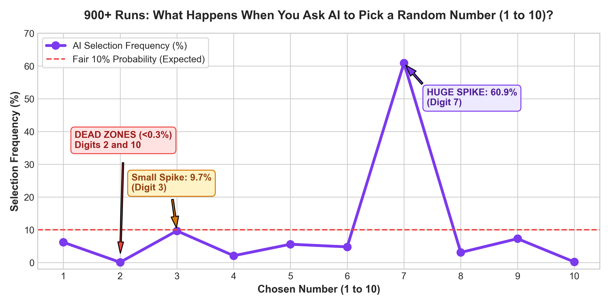

# 🎲 Can AI Generate Random Numbers? The LLM Fails Miserably Here.

> **"Pick a random number between 1 and 10."**  

You expect an even, fair 10% chance for each digit.  
**What AI actually does will blow your mind!!!**

### <u>If this was a casino game, the house would be bankrupt in minutes.</u>

---

## The Reality: AI Absorbed Human Flaws

We think Artificial Intelligence is pure, cold mathematical logic. **It isn't.**

When an LLM generates a response, it doesn't roll a true die—it predicts the next most likely token based on trillions of words written by **humans**. 

And humans are terribly predictable:
* Ask a human to pick a random number from 1 to 10, and most instinctively shout **7**.
* Humans avoid even numbers because they feel "too calculated."
* Humans skip 1 and 10 because they are edges.

<u>We tested modern LLMs across **900+ automated trials** at Temperature = 0.8 with multiple open source LLM's. The result? **AI copied human cognitive bias completely.**</u>

---

### !!! Quick Stats That Hurt:
* **The "Lucky 7" Trap:** Over **60.9%** of all selections collapsed onto **7** (peaking at a crazy **94%** in Qwen-4B!).
* **The "3" Rebound:** Digit **3** had a secondary peak whenever the AI was told not to repeat itself.
* **Dead Zones:** Digits **2 (0.1%)** and **10 (0.2%)** were practically **never chosen**.

---

## 📊 The Shocking Result: Look at This Curve!

Here is the exact distribution across 900+ real tests:

---

## 🔍 What's Really Happening Under the Hood?

### 1. The "Ping-Pong" Memory Trap (7 vs 3)
When we gave the model short-term memory:  
`"Your previous choice was 7. Now pick a random number."`

The self-attention heads penalized token **7** to avoid repeating itself. But instead of picking randomly, <u>the AI immediately panicked and fell back to the second most popular human choice: **digit 3**</u>. 

It bounced back and forth like a ping-pong ball: **7 ➔ 3 ➔ 7 ➔ 3**.

---

### 2. Micro-Models & "The Prompt Leak" (Sub-1B Models)
When we tested the compact **Qwen 0.5 Billion parameter model**, something even weirder happened. 

Digit **1** spiked to nearly **40%**! Why?

Because the prompt said: *"Pick a number between **1** and 10."*

<u>Sub-1B models have fewer attention layers and shallow token separation. The boundary digit **"1"** from the prompt literally **leaks straight through into the output**!</u> It wasn't being creative; it was simply repeating what it just read.

---

### 3. Does "Reasoning / Thinking" Save It?
When we allowed the model to "think" (`<think>...</think>`) before answering, the extra reasoning steps scrambled the instant token bias. 

The probability finally spread out towards 5 and 3. But reasoning costs 10x more time and compute just to pick a single number.

---

## The Golden Rule: NEVER Use LLMs for Randomness

Whether you are building:
* 🎲 Lottery / Raffle systems
* 🧪 A/B testing user traffic
* 🃏 Shuffling games or cards
* 🔐 Security tokens or salts

<u>**Never ask an LLM to be random.**</u> 

LLMs are prediction engines built to reproduce human patterns, not random number generators. Always use native code:
* Python: `random.choice()` or `secrets.randbelow()`
* JavaScript: `crypto.getRandomValues()`

Save AI for reasoning, and leave the dice rolling to your CPU!

---

## 💻 Explore the Raw Data & Code

Want to inspect the raw CSVs, explore all 900+ test runs, or re-run the experiments yourself?

🔗 **GitHub Repository & Full Dataset:**  
👉 [https://github.com/NamanBeri/llm-randomness-bias-study](https://github.com/NamanBeri/llm-randomness-bias-study)

